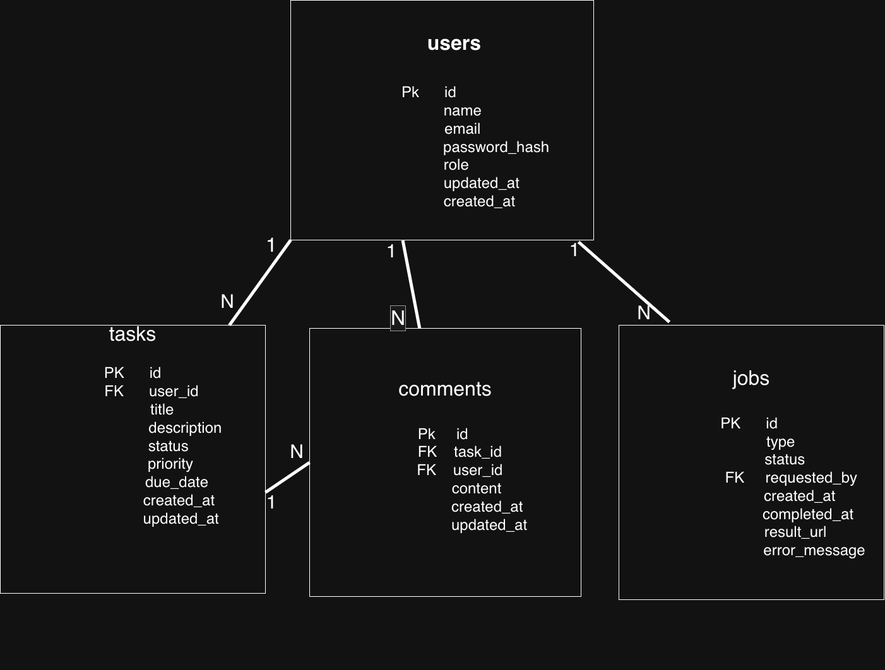

# Database Design

For this project, I am using PostgreSQL as the database.

The Task Manager application will mainly store users, tasks, comments and background jobs.

## Tables

The database will have these 4 main tables:

- users
- tasks
- comments
- jobs

## 1. Users Table

The `users` table stores the basic information of users who use the application.

| Column | Type | Constraints | Purpose |
|---|---|---|---|
| id | BIGINT | Primary Key | Unique ID of the user |
| name | VARCHAR(100) | NOT NULL | User name |
| email | VARCHAR(255) | NOT NULL, UNIQUE | User email |
| password_hash | VARCHAR(255) | NOT NULL | Stores hashed password |
| role | VARCHAR(20) | NOT NULL | User role |
| created_at | TIMESTAMPTZ | NOT NULL | Account creation time |
| updated_at | TIMESTAMPTZ | NOT NULL | Last update time |

I am storing `password_hash` instead of the actual password. Passwords should not be stored as plain text.

The role can be:

- `USER`
- `ADMIN`

---

## 2. Tasks Table

The `tasks` table stores the tasks created by users.

| Column | Type | Constraints | Purpose |
|---|---|---|---|
| id | BIGINT | Primary Key | Unique task ID |
| user_id | BIGINT | NOT NULL, Foreign Key | User who owns the task |
| title | VARCHAR(200) | NOT NULL | Task title |
| description | TEXT | Optional | Task details |
| status | VARCHAR(30) | NOT NULL | Current task status |
| priority | VARCHAR(20) | NOT NULL | Task priority |
| due_date | DATE | Optional | Task due date |
| created_at | TIMESTAMPTZ | NOT NULL | Task creation time |
| updated_at | TIMESTAMPTZ | NOT NULL | Last update time |

The `user_id` connects a task with the user who owns it.

```text
tasks.user_id -> users.id
```

Task status can be:

- `TODO`
- `IN_PROGRESS`
- `COMPLETED`
- `CANCELLED`

Task priority can be:

- `LOW`
- `MEDIUM`
- `HIGH`

---

## 3. Comments Table

The `comments` table stores comments added to tasks.

| Column | Type | Constraints | Purpose |
|---|---|---|---|
| id | BIGINT | Primary Key | Unique comment ID |
| task_id | BIGINT | NOT NULL, Foreign Key | Task related to the comment |
| user_id | BIGINT | NOT NULL, Foreign Key | User who added the comment |
| content | TEXT | NOT NULL | Comment text |
| created_at | TIMESTAMPTZ | NOT NULL | Comment creation time |
| updated_at | TIMESTAMPTZ | NOT NULL | Last update time |

The relationships are:

```text
comments.task_id -> tasks.id
comments.user_id -> users.id
```

So one task can have multiple comments, and a user can add comments to different tasks.

---

## 4. Jobs Table

The `jobs` table is used for long-running operations.

For this project, I am using task CSV export as an example of a background job.

| Column | Type | Constraints | Purpose |
|---|---|---|---|
| id | UUID | Primary Key | Unique job ID |
| type | VARCHAR(50) | NOT NULL | Type of background job |
| status | VARCHAR(30) | NOT NULL | Current job status |
| requested_by | BIGINT | NOT NULL, Foreign Key | User who requested the job |
| created_at | TIMESTAMPTZ | NOT NULL | Job creation time |
| completed_at | TIMESTAMPTZ | Optional | Job completion time |
| result_url | VARCHAR(500) | Optional | Location of generated file |
| error_message | TEXT | Optional | Error details if the job fails |

The relationship is:

```text
jobs.requested_by -> users.id
```

The job status can be:

- `QUEUED`
- `RUNNING`
- `COMPLETED`
- `FAILED`

For example, when a user requests a task export, a job can first be created with `QUEUED` status. It can then move to `RUNNING` and finally to `COMPLETED` or `FAILED`.

---

## Relationships

The main relationships between the tables are:

```text
users 1 ---- N tasks

users 1 ---- N comments

tasks 1 ---- N comments

users 1 ---- N jobs
```

In simple terms:

- One user can have many tasks.
- One user can add many comments.
- One task can have many comments.
- One user can request many background jobs.

---

## Primary Keys

Each table has its own primary key.

| Table | Primary Key |
|---|---|
| users | id |
| tasks | id |
| comments | id |
| jobs | id |

A primary key is used to uniquely identify each record in a table.

---

## Foreign Keys

Foreign keys are used to connect related tables.

| Table | Foreign Key | References |
|---|---|---|
| tasks | user_id | users.id |
| comments | task_id | tasks.id |
| comments | user_id | users.id |
| jobs | requested_by | users.id |

For example, if a task has `user_id = 5`, it means that task belongs to the user whose `id` is `5` in the `users` table.

---

## Allowed Values

Some columns will have predefined values.

### User Role

```text
USER
ADMIN
```

### Task Status

```text
TODO
IN_PROGRESS
COMPLETED
CANCELLED
```

### Task Priority

```text
LOW
MEDIUM
HIGH
```

### Job Status

```text
QUEUED
RUNNING
COMPLETED
FAILED
```

---

## Database Notes

- PostgreSQL is used as the relational database.
- Primary keys uniquely identify records.
- Foreign keys are used to maintain relationships between tables.
- Passwords are stored as hashes and not as plain text.
- `TIMESTAMPTZ` is used for date and time fields.
- Tasks belong to users.
- Comments belong to tasks and are created by users.
- Jobs are used to track long-running background operations.


## ERD

The ERD shows the tables and their relationships.



//first doc of db